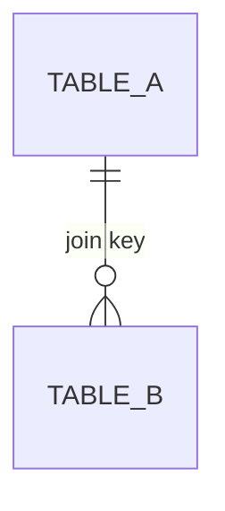

# Design: analytics requirements document (ARD)

Goes under "Answer" in the note. Delete the guidance in angle brackets. Metric definitions live here.

## Headline
<One or two sentences: what can be measured today, what cannot, and what must be built.>

## Objective and decision
<The objective and the decision this measurement supports.>

## Metric definitions
| Metric | Numerator | Denominator | Exclusions | Anchor | New or existing |
|--------|-----------|-------------|------------|--------|-----------------|
| <name from metrics.md, or new> | | | | | |
New definitions are added to `metrics.md` after Tejas approves them.

## Instrumentation
| Event or field | Properties | Trigger (when it fires) | Owner system | Status | Where the status comes from |
|----------------|------------|-------------------------|--------------|--------|----------|
| <name> | | | | Present / Partial / Missing | schema.md, the product docs, or a check |

## Data model (ER diagram)

<Built from the join keys in schema.md. Name any unverified key here.>

## Data checks and gaps
<For each field: does it exist, is it filled, is it reliable. List gaps.>

## Open questions for engineering
<List.>

## Paste-ready block for the PRD
<Metrics and instrumentation, ready to paste.>

## Evidence
<Results of any probe or check, cited by metric, script and output file (local only).>
